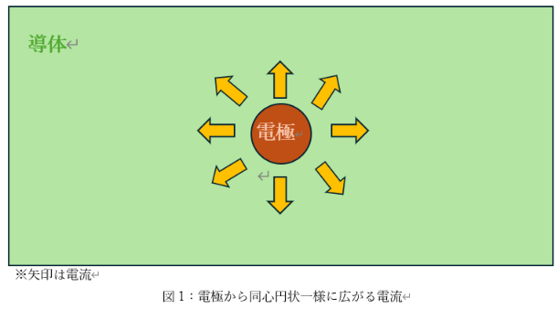
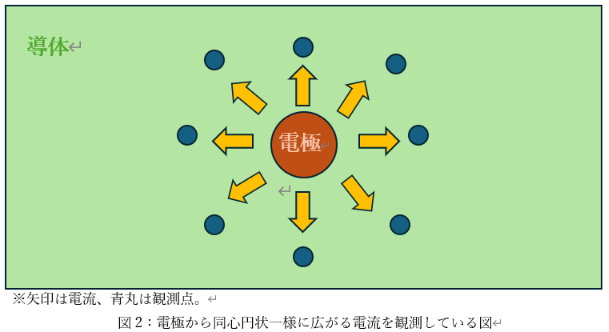

---
title:無知な人間の考えた専門装置
title:１個目～めっき処理後の表面特性分析器～
date: 2026-11-12
---

「無知な人間の考えた専門装置」とは、その分野に対してあまり専門知識のない筆者が、
独自の思い付きと考察でいろいろな装置を考案していくものです。
記念すべき一個目の装置は、「めっき処理後の表面特性分析器」です。
これを考えるきっかけとなったのが、現電気研究部部長のこのツイート⇓

このツイートを目にした瞬間、筆者の脳内に閃きが走った！
「電気抵抗を測れば行けるんじゃね？」と

筆者の個人的な考えでは、電流とは一般に電気の流れやすい物質がある方向により多く流れる。
一様に胴体が分布していれば電流は放射状に流れるはずである（本当かどうかは知らないが…）。

また、電気抵抗というものは、当然、母材とメッキ材では異なっているはずなので、一定の距離における電気抵抗を複数の箇所調べれば、ある程度のメッキ厚が分かるはずである。
つまり、次ページのような装置で同心円状に広がる電流の抵抗値を測ることで、メッキ厚からメッキの表面特性も分かると考える。

中央に電極があり、同心円状にもう一つの電極がある。
もう一つの電極を図2のように等間隔同心円状に配置し、電極間の距離と抵抗値から表面特性を算出する。

筆者は、実際にこのような装置があるのかは知らない。機械工学科で液浸冷却を研究する身にあっては、恐らくこのような測定を行う日は来ないかと思われるが、「めっき」は機械工学、電気電子工学、材料工学、応用化学など広く一般に使われている技術であり、些細な事柄でも少しは考えを深めておくことも重要と考える。

