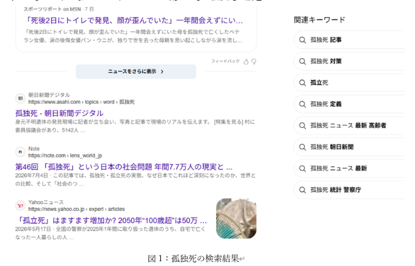
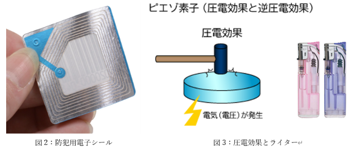
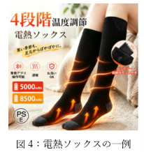

---
title:無知な人間の考えた装置・物体
title:2個目～圧電ソックス～
date: 2026-11-17
---

「無知な人間の考えた装置・物体」とは、その分野に対してあまり専門知識のない筆者が、
独自の思い付きと考察でいろいろな装置やモノを考案していくもの。
二個目の装置は、「圧電ソックス」。
これを考えるきっかけとなったのが、ニュースで流れてきた孤独死の話題⇓

かく言う筆者の親族にも、かつては聡明であったものの、加齢に伴う衰えから倒れ、誰にも看取られることなく孤独死してしまった人がいる。
将来、独り身になる確率が超MAXである筆者にとっても、決して他人事ではない話題なのである。

さて、孤独死による発見の遅れを防ぐ最も手っ取り早い方法は、至極単純。「さっさと見つけること」である。

しかし、現実にはそう簡単にいかない。
高齢者の中には認知機能の低下などによって徘徊してしまう人もおり、常に居場所や安否を把握することは容易ではない。

そこで筆者は閃いた！
「普段使いの履物や靴下に、圧電素子を利用した小型発信器でも取り付ければ、日常の行動を可視化できるのではないか？」と…

仕組みは至って単純である。
普段使用する履物や靴下に圧電素子を利用した小型発信器を取り付け、住宅内や各所に設置された受信機によって、その位置や活動状況を把握するというものだ。
裸足で外出してしまうような高齢者を除けば、多くの人は日常的に決まった靴下や履物を身に着けて移動するだろう。

つまり、日常生活に欠かせないものに発信器を組み込んでしまえば、本人が特別な操作をすることなく、ある程度の行動を把握できるのではないかという考えである。

一定時間にわたって電波の送信が確認できなければ、家族や関係者に通知する仕組みを設けることで、異常の早期発見につながる可能性がある。
また、カメラによる見守りとは異なり、映像を撮影する必要がないため、プライバシーへの影響を比較的小さく抑えられる。
さらに、発信器を身に着けている限り、カメラの死角に入ったり、カメラそのものを動かされたりすることで見守りの対象から外れてしまう問題も軽減できるだろう。
オプションとして大きめの液晶に今日歩いた歩数と歩数ごとに表示内容を変えれば、本人の生活にも少しは彩を加えることができるかもしれない。

＜原理＞
筆者の認識では、圧電素子とは、外部からの圧力や変形により発電する素子である。
身近な例としては、ガスライターの着火装置が思い当たる。
もっとも、圧電素子から得られる電力は火花を一瞬ちらつかせる程度のもので、常時複雑なデータを送信することは難しいだろう。

しかし、世の中には、ごくわずかな電力で動作する無線通信技術がある。

例えば、店舗の盗難防止タグなどには、外部から受け取った電波のエネルギーを利用して瞬間的に動作し、識別情報を送信するものがある。

もちろん、これらは圧電素子による発電とは原理が異なるが、微小な電力でも情報をやり取りできるという点では参考になる。
歩行時に足裏へ加わる圧力や変形を利用して発電し、その電力を微小なコンデンサに蓄え、一定量の電力が確保できたら短い信号を送信する。数歩歩くごとに発電した電力を蓄積し、発信器固有の識別情報を送り、住宅内などに設置された受信機がその信号を受け取る。

こうすれば、少なくとも「その人がいつ、どの受信機の近くで活動していたか」が分かるのではないだろうか。

このように、母機は常にコンセントにより給電され、子機の電力を気にしなくていい仕組みであればメンテナンスも省くことができる。
筆者はこのような装置があるのかは知らないが、少なくとも、電熱機能付きの靴下は見たことがある。
すでにこのような製品があるならば、十分に実用化の見込みもあるのではないだろうか。もちろん、子機側の耐久性や通信距離など技術的に難しいところが多いだろう。
（それ以前に、どうやって街中に母機（受信機）を置くというのか…）
しかし、難しいことはひとまず置いておき、ふとした発想をより具体化するという行為は、生きていく中でもそれなりに大切だと筆者は考える。

